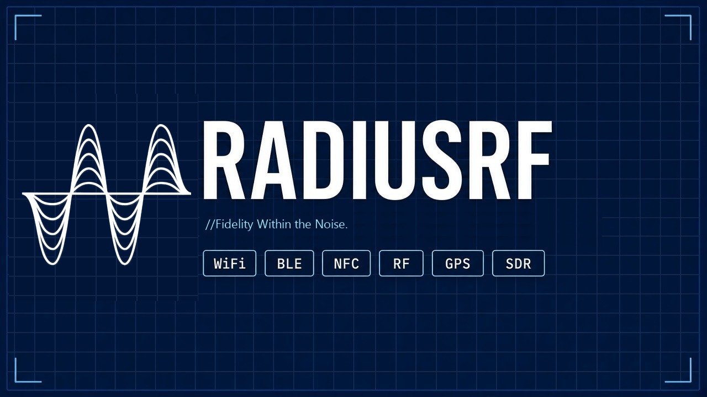
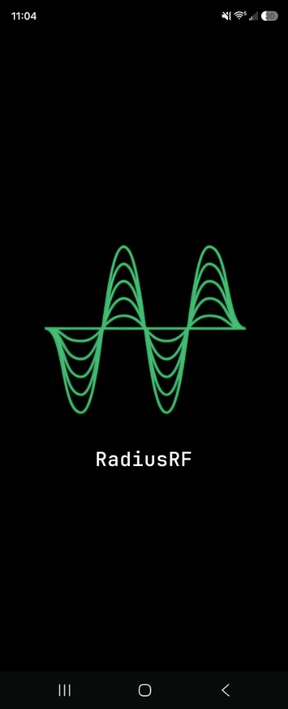
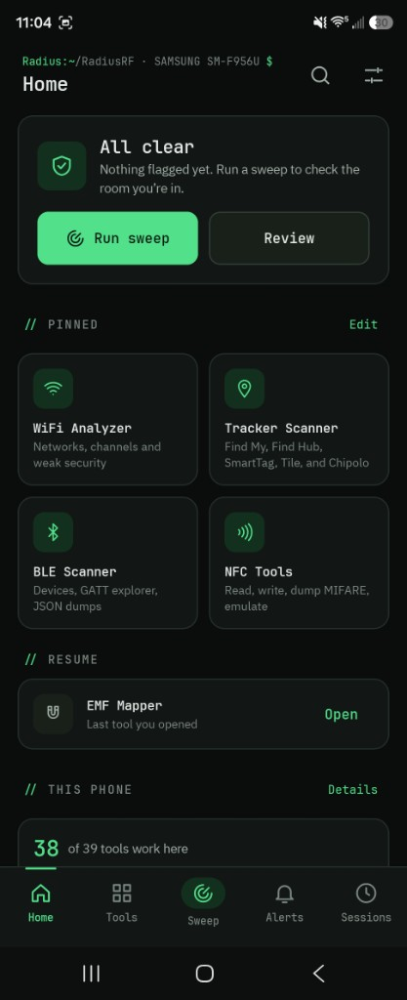
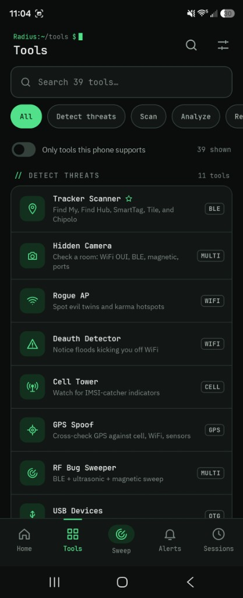
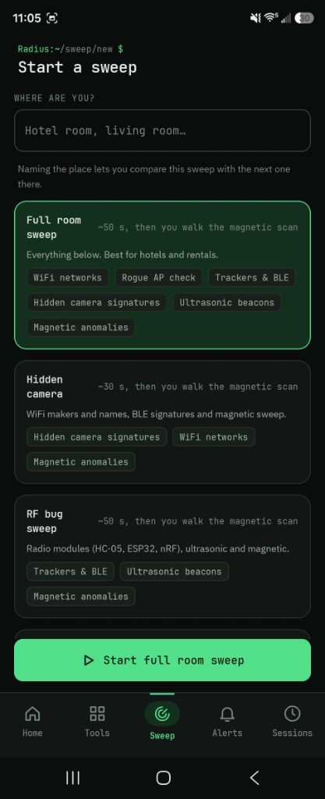
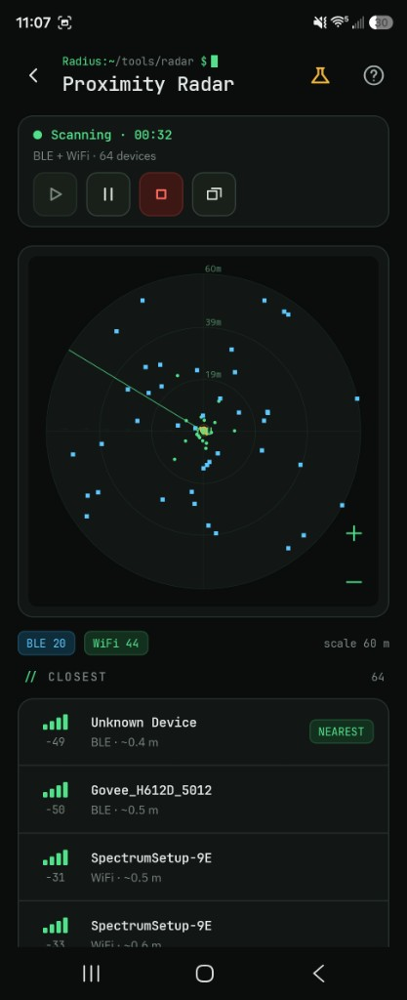
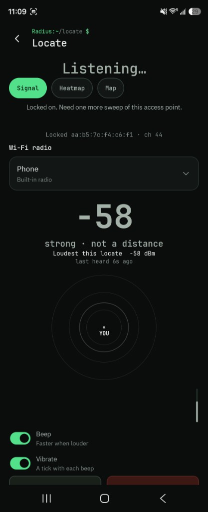
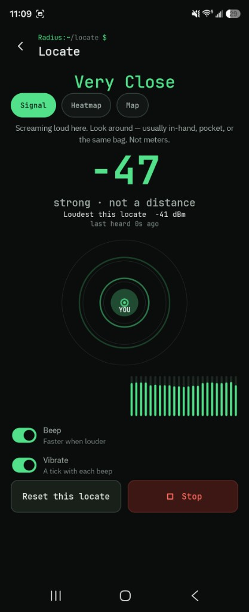
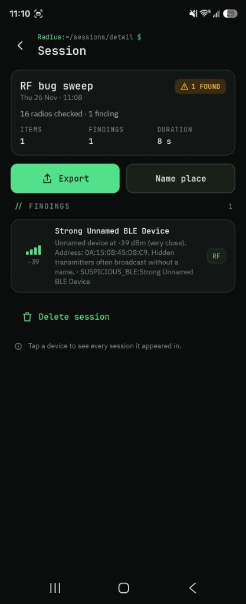
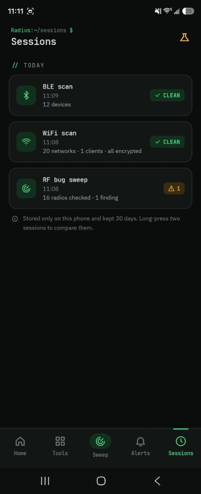

  

<h1 align="center">RadiusRF</h1>

  A receive-only radio and network awareness app for Android.

  <strong>See what this phone can already hear.</strong> 
  Wi-Fi, Bluetooth, cellular, GPS, and optional USB receivers — <b>39 tools in one app</b>. Nothing is sent to attack a network.

---

## ⚡ At a Glance

RadiusRF shows the radios, sensors, and ports this phone already has — Wi-Fi, Bluetooth, BLE, NFC, IR, UWB, USB, GPS, cellular, magnetometer, barometer, and microphone — through **39 tools**. A scan starts when you open a tool and tap start. It stops when you leave that screen.

|  |  |
|---|---|
|  **39 tools** | Detect threats · Scan · Analyze · Read / write · Log |
|  **Radios** | Wi-Fi, BLE, Classic Bluetooth, NFC, IR, UWB, cellular, GPS, and optional USB receivers |
|  **No idle scan** | Nothing starts on its own. Services load when a tool needs them |
|  **On this phone** | No account. Logs stay on the device. Map tiles and Play Services for AR are the exceptions. A file leaves only when you share it |
|  **Android 8.0+** | Min SDK 26, target SDK 36 |
|  **Stack** | Kotlin · Jetpack Compose · Material 3 |

> For a person checking the signals around their own phone, and for network work they are allowed to do.

---

## Screenshots

<table>
<tr>
<td align="center"> Launch</td>
<td align="center"> Home</td>
<td align="center"> Tools</td>
</tr>
<tr>
<td align="center"> Sweep</td>
<td align="center"> Proximity Radar</td>
<td align="center"> Locate</td>
</tr>
<tr>
<td align="center"> Locate, very close</td>
<td align="center"> A saved sweep</td>
<td align="center"> Sessions, on this phone</td>
</tr>
</table>

---

## What a reading means

A row in this app is a report from the phone or from an attached receiver. It is a reason to look, not proof that a device is hostile, and a quiet screen is not proof that nothing is there.

- **Trackers.** Find My, Find Hub, SmartTag, Tile, Chipolo, and Amazon advertisements. A tag that is still with its owner stays quiet. A tracker that uses only the cell network is invisible here.
- **Wi-Fi.** Network names, channels, weak security, and look-alike names. Floor walk maps the network this phone is already joined to.
- **Cell.** The serving cell, the neighbours, and a note when the phone drops to 2G. That note is a change in the record. It is not an identification of a cell-site simulator.
- **Deauth Detector.** Deauthentication and disassociation frames heard on a USB adapter. The tool does not transmit.
- **USB.** The interfaces on a plugged-in device, including a keyboard and storage together.
- **Ultrasonic.** Narrow tones between 18 and 24 kHz, when you start that tool.
- **Connection Log.** This phone’s own apps, hosts, and bytes. Android’s VPN interface is used only to observe and forward IPv4. It is not a remote VPN.

---

## 🧰 Features

Every tool solves a specific, real problem. Full step-by-step docs live in the **[📖 Complete Tool Guide →](docs/TOOLS.md)**.

The Tools screen lists **39 tools** in five groups. Step-by-step manuals are in the **[Complete Tool Guide](docs/TOOLS.md)**.

<b>Detect threats · 11</b>

| Tool | What it does |
|------|--------------|
| **Tracker Scanner** | Find My, Find Hub, SmartTag, Tile, Chipolo, and Amazon. A tag still with its owner stays quiet. |
| **Hidden Camera** | Wi-Fi vendor and name, BLE, magnetometer, and open video ports |
| **Rogue AP** | Evil twins, look-alike names, and karma hotspots |
| **Deauth Detector** | Deauthentication and disassociation frames on a USB adapter. Nothing is transmitted. |
| **Cell Tower** | Serving cell and neighbours, with drops to 2G called out |
| **GPS Spoof** | Seven checks of GPS against cell, Wi-Fi, and sensors |
| **RF Bug Sweeper** | BLE module names, ultrasonic tones, and magnetic anomalies |
| **USB Devices** | USB interfaces, including a keyboard-plus-storage combination |
| **QR Scanner** | Decodes a code and checks the link before it is opened |
| **Privacy Score** | Weighted checks across Wi-Fi, Bluetooth, the device, the network, and physical sensors. A separate list shows what any app can read. |
| **Signature Watch** | Find Hub, camera-glasses names, action cams, and serial-module names |

<b>Scan · 11</b>

| Tool | What it does |
|------|--------------|
| **WiFi Analyzer** | Networks, channels, and weak security. Floor walk maps the joined network and can share a PNG. |
| **BLE Scanner** | Devices, GATT explorer, and JSON dumps |
| **Bluetooth Classic** | Discovery, SDP services, and an SPP serial terminal |
| **Network Scanner** | Hosts, ports, banners, mDNS, and SSDP on the LAN you are joined to |
| **Connection Log** | This phone’s apps, hosts, and bytes, plus a PCAP. The VPN interface only observes and forwards IPv4. It is not a remote VPN. IPv6 stays on the normal connection. |
| **Proximity Radar** | Nearby devices plotted by estimated distance. Pinch to zoom. |
| **FTM Ranging** | 802.11mc distance to access points that answer |
| **Mesh Network Scanner** | Bluetooth companion links and LoRa mesh broadcasts. Hear only. |
| **Wi-Fi Aware** | Router-less NAN discovery |
| **SDR Radio** | Receive console: waterfall, audio, and decoders. Status: Beta Test. |
| **USB Camera** | UVC modes and preview |

<b>Analyze · 8</b>

| Tool | What it does |
|------|--------------|
| **ISM Decoder** | Names 315/433/868/915 MHz sensor bursts from pulse timing |
| **ADS-B / AIS** | Nearby aircraft on 1090 MHz and ships on 162 MHz |
| **Fox Hunt** | The compass heading where one tuned frequency is strongest |
| **Ultrasonic** | 18–24 kHz spectrum for narrow tones |
| **EMF Mapper** | Magnetic-field grid and hotspots |
| **Sensor Dashboard** | Motion, compass, level, and a metal detector |
| **GPS Tracker** | Position, satellites, and raw NMEA |
| **UWB Radar** | FiRa ranging and angle of arrival, on phones that have UWB |

<b>Read / write · 3</b>

| Tool | What it does |
|------|--------------|
| **NFC Tools** | Read and write NDEF, dump MIFARE Classic, emulate a Type 4 tag |
| **IR Remote** | TV remotes and Flipper `.ir` import, on phones with an IR blaster |
| **Wi-Fi Direct** | P2P groups and file transfer |

<b>Log · 6</b>

| Tool | What it does |
|------|--------------|
| **Field Map** | Survey pins, Bluetooth and Wi-Fi Remote ID, fox-hunt bearing, and mapped cameras |
| **Signal Logger** | Wi-Fi and BLE arrival and departure timeline |
| **Wardriving** | GPS + Wi-Fi log. Export WiGLE, Kismet, airodump-ng, PCAPNG, and CSV |
| **Wardriving +** | GPS + Wi-Fi + Bluetooth, same exports |
| **Wardriving ++** | GPS + Wi-Fi + Bluetooth + cellular, same exports |
| **Run Compare** | Devices that stayed with you across saved wardriving runs |

**Locate** follows one Wi-Fi access point or one Bluetooth device while you walk. The cue says whether that target is getting louder or quieter. It does not give a compass heading or a distance in meters. It is opened from WiFi Analyzer, BLE Scanner, or a sweep finding, and it is not one of the 39 tools.

**Alert Center** is the shared feed of findings from the detectors. It is a tab, not one of the 39 tools.

---

## ❓ FAQ

<b>Is RadiusRF legal to use?</b>

The app is legal. How you use it is your responsibility. Only inspect networks, radios, and devices you **own or are allowed to look at**. See the [Disclaimer](#-disclaimer) and the in-app Ethical Use Agreement.

<b>Does it require root?</b>

No. RadiusRF uses only standard Android APIs and runtime permissions — no root, no custom ROM.

<b>Why does it ask for location permission?</b>

Android **requires** location permission to return WiFi and Bluetooth scan results — it's a platform rule, not a data grab. Permissions are requested only when you open a feature that needs them.

<b>Will every tool work on my phone?</b>

No — tools depend on your hardware (IR blaster, UWB, barometer, etc. aren't on every device). The **Dashboard shows exactly which capabilities your device has** so you know what will work. See [Hardware Compatibility](docs/HARDWARE.md).

<b>Does it drain my battery?</b>

Nothing scans until you open a tool and start it. The scan stops when you leave that screen. Some short scans also end on their own. See [Battery Optimization](docs/BATTERY.md).

<b>Is my data collected?</b>

There is no login and no account. Surveys, logs, and captures stay on the phone. Field Map and wardriving can download map tiles. Floor walk uses Play Services for AR, and the camera frames are not saved. A floor-walk image or a PCAP leaves the phone only when you tap share. The full note is in [PRIVACY.md](PRIVACY.md).

---

## 🏗️ Architecture

MVVM (`Screen → @HiltViewModel → Domain → Hardware`), Hilt DI, all services lazy-initialized, no auto-start scanning. Full design decisions and directory layout: **[📖 Architecture Guide →](docs/ARCHITECTURE.md)**

---

## 🔋 Battery Optimization

Zero idle battery: no auto-start scanning, 5Hz sensor polling, `SCAN_MODE_LOW_POWER` BLE, everything auto-stops and lazy-loads. Full before/after breakdown: **[📖 Battery Optimization →](docs/BATTERY.md)**

---

## 🔐 Permissions

RadiusRF requests permissions **only when you open a feature that needs them** — nothing at startup. Full permission-by-permission breakdown: **[📖 Permissions →](docs/PERMISSIONS.md)**

---

## 📱 Hardware Compatibility

Not all phones have all hardware. The Dashboard shows which capabilities your device has. Full hardware → feature matrix: **[📖 Hardware Compatibility →](docs/HARDWARE.md)**

---

## 🛠️ Tech Stack

  
  
  
  
  
  
  
  

<b>Architecture:</b> MVVM (ViewModel + StateFlow + Compose) · Hilt DI · Room (auto-migration) · Dark Material 3 theme with JetBrains Mono

<b>Full dependency versions</b>

| Layer | Technology |
|-------|-----------|
| Language | Kotlin 2.4.10 |
| UI Framework | Jetpack Compose (BOM 2026.06.01) |
| Design System | Material 3 (dark theme, JetBrains Mono, CutCornerShape) |
| Architecture | MVVM (ViewModel + StateFlow + Compose) |
| Navigation | Jetpack Navigation Compose 2.9.8 |
| DI | Hilt 2.60.1 |
| Database | Room 2.8.4 (6 entities, auto-migration) |
| Camera | CameraX 1.6.1 |
| Barcode | ML Kit Barcode 17.3.0 + ZXing 3.5.4 |
| Location | Play Services Location 21.4.0 |
| Ranging | Jetpack Core UWB 1.0.0 |
| Permissions | Accompanist Permissions |
| Build | Gradle 9.7.0, AGP 9.3.1 |
| Min / Target SDK | 26 (Android 8.0) / 36 · compile SDK 37 |

---

## Privacy

There is no account. Logs stay on the phone. Map tiles, Play Services for AR, and a share you start yourself are the exceptions. Details: **[PRIVACY.md](PRIVACY.md)**.

---

## Licenses

Source for this app is this repository: [github.com/Undrcrrnt/RadiusRF](https://github.com/Undrcrrnt/RadiusRF).

The receive path for some USB Wi-Fi adapters includes the Jaguar receive core from [devourer](third_party/devourer), which is GPL-2.0. The license text shipped in the app is [LICENSE-devourer.txt](app/src/main/assets/LICENSE-devourer.txt). Transmit examples from that project are not included.

USB access uses libusb, LGPL-2.1, built as its own shared library. See [third_party/libusb/COPYING](third_party/libusb/COPYING).

The Airspy and HydraSDR libraries keep the notices in [third_party/airspy/LICENSE.md](third_party/airspy/LICENSE.md) and [third_party/hydrasdr/LICENSE.md](third_party/hydrasdr/LICENSE.md).

---

## ⚖️ Ethical Use

RadiusRF shows an **Ethical Use Agreement** on first launch that cannot be dismissed. Users must accept:

-  Use only on networks and devices you own or are authorized to test
-  Comply with all local laws on wireless scanning and network analysis
-  No unauthorized surveillance, tracking, or network attacks
-  Report vulnerabilities responsibly through proper channels

Declining the agreement exits the app.

---

## 💬 Support

-  **Bugs & feature requests:** [open an issue](https://github.com/Undrcrrnt/RadiusRF/issues)
-  **Security disclosures:** please report privately via [SECURITY.md](SECURITY.md) rather than in a public issue

If RadiusRF is useful to you, consider **starring the repo** ⭐ — it helps others discover the project.

---

## ⚠️ Disclaimer

RadiusRF is a personal awareness app. Use it on networks, radios, and devices you own or are allowed to inspect.

The tools report what the phone or an attached receiver heard. Using them to access, monitor, disrupt, or attack networks, devices, or people **without permission is illegal** in most jurisdictions and is **not** the intended use of this software.

- You are solely responsible for how you use RadiusRF and for complying with all applicable laws.
- Only scan, probe, or test networks and devices you **own** or have **written permission** to assess.
- What a tool shows is what the phone or the attached adapter reported. Do not treat a reading as proof of a threat, and do not treat a quiet screen as proof that nothing is there.
- The author accepts **no liability** for misuse or for any damages arising from use of this software. It is provided "as is", without warranty of any kind.

By building, installing, or using RadiusRF, you agree to these terms and to the in-app Ethical Use Agreement.

  Built with ☕ and Kotlin · If you find RadiusRF useful, drop a ⭐

 
